# FCW Watch / Vault — QR core

[](https://gitlab.com/aa22396584/flutter-cold-wallet/-/releases)

**Canonical repository and downloads:** <https://gitlab.com/aa22396584/flutter-cold-wallet> · [GitHub mirror](https://github.com/akari-sora/flutter-cold-wallet)

**Current Android release:** [1.2.1+10 (r25 testnet)](https://gitlab.com/aa22396584/flutter-cold-wallet/-/releases/v1.2.1). Watch and Vault are available to selected testers in the Taiwan Google Play closed Alpha. Play-installed acceptance and cross-channel updates remain unverified. Physical camera optics, OEM authentication and physical offline-device isolation also remain unverified.

**目前 Android 版本：** [1.2.1+10（r25 測試網）](https://gitlab.com/aa22396584/flutter-cold-wallet/-/releases/v1.2.1)。Watch 與 Vault 已提供台灣 Google Play 封閉 Alpha 指定測試人員使用；Play 安裝與跨管道更新，以及實體鏡頭、OEM 驗證和離線裝置隔離仍未驗證。請勿使用真實助記詞或資金。

This public tree was prepared after the binary build from the independently reviewed corresponding-source archive. Earlier repository documentation below is historical unless this page or [PUBLICATION.md](PUBLICATION.md) says otherwise.

**English summary.** FCW is an experimental, air-gapped cryptocurrency wallet made of two Flutter apps that share a Rust core:

- `apps/wallet` (**FCW Watch**) is an online, **watch-only** wallet. It holds public keys only, builds unsigned transactions, verifies returned signatures and broadcasts.
- `apps/vault` (**FCW Vault**) is an **offline signer**. It creates or restores a BIP-39 wallet, keeps the encrypted seed on the device, shows every field of a request before approval, and signs. The Android release build has no `INTERNET` permission.
- The two apps never connect to each other. Pairing data, unsigned requests and signatures move as static or animated QR codes (BC-UR), so the Vault phone can stay offline. Supported today: EVM Legacy, EIP-1559 and whitelisted ERC-20 transfers, and Bitcoin PSBT v0 (P2WPKH), with a fail-closed policy engine.

**Status and warnings — read before using it.**

Android acceptance takes priority. Historical testnet candidates and Phase 0 development work have separate evidence; see the archived [Android status and next acceptance](docs/ANDROID_STATUS.md). The accepted [ADR-005](docs/ADR/ADR-005-mainnet-networks.md) describes the later network phases.

- **Test networks only.** The EVM policy accepts only Sepolia (11155111) and local development chains (1337, 31337); Bitcoin signing is enabled for regtest only. Mainnet requests are rejected. Do not use it with a real mnemonic or real funds.
- **Not audited.** No third-party security audit has been done. The review notes in `docs/` are the project's own testing and AI-assisted code review.
- **Testnet preview.** Version `1.2.1+10` (r25) is signed with the original app-signing identities enrolled with Google Play. Both apps are available in Taiwan closed Alpha; Play-installed acceptance and cross-channel updates have not been run. Check each APK certificate fingerprint in the [current release](https://gitlab.com/aa22396584/flutter-cold-wallet/-/releases/v1.2.1) before installing. Builds made without `key.properties` use the local Android debug keystore and are test builds.
- Physical camera-to-camera scanning, real-device biometrics, iOS execution and the stock OKX signature return path are still open; see [docs/REMAINING_WORK.md](docs/REMAINING_WORK.md).
- **Use at your own risk.** The software is provided without warranty (see [LICENSE](LICENSE)).

Project repository: <https://gitlab.com/aa22396584/flutter-cold-wallet>. The separately published [corresponding source archive](https://pages.stickerstudio.xyz/fcw/source/1.2.1-10/) is the precise source distribution for these APKs. Both apps embed an About page with the privacy policy ([English](docs/privacy/privacy-policy.en.md), [zh-TW](docs/privacy/privacy-policy.zh-TW.md)).

Commit SHAs, candidate numbers (`r9`, `r14`, …) and APK hashes quoted in `docs/` and `CHANGELOG.md` refer to the private development archive and its local builds; this repository snapshot starts from a single initial commit.

Much of the documentation and the whole app UI are in Traditional Chinese (zh-TW). Build instructions, tooling notes, security and contribution policies are in English below and in [SECURITY.md](SECURITY.md) and [CONTRIBUTING.md](CONTRIBUTING.md).

---

# Flutter Wallet / Vault：QR 核心版本

本專案包含兩個 Flutter 應用程式：連網觀察錢包 `apps/wallet`（watch-only Wallet）與離線簽署金庫 `apps/vault`（offline Vault signer）。
兩端透過動態／靜態 QR 碼（UR）以氣隙（air gap）方式交換配對資料、待簽交易與簽章，目前僅供 local/testnet 測試使用。
目前版本為 `1.2.1+10`（r25），是測試網預覽版，不得用於正式助記詞、真實資產或主網交易。兩個 App 已提供台灣 Google Play 封閉 Alpha 指定測試人員使用，Play 安裝與跨管道更新仍待驗證。APK 的憑證指紋列在[目前發版說明](https://gitlab.com/aa22396584/flutter-cold-wallet/-/releases/v1.2.1)，安裝前請核對。
自行建置且沒有 `key.properties` 時，release 組態以建置機器的 Android debug keystore 簽署，屬於測試建置；debug 金鑰沒有保護，簽章無法證明安裝包由誰建置。簽章指紋與發版說明不符的 APK 一律視為不可信。本專案未經第三方安全稽核。

2026-10-15 起的工作重心是 `apps/wallet` 與 `apps/vault` 的 local/testnet 核心使用流程。NFC 已延後；原始碼與測試保留，延後不代表通過。完整目標尚未結案。

## 畫面預覽（1.2.1）

基於安全原則，助記詞相關畫面不納入截圖。

<table>
  <tr>
    <td align="center" valign="top">
      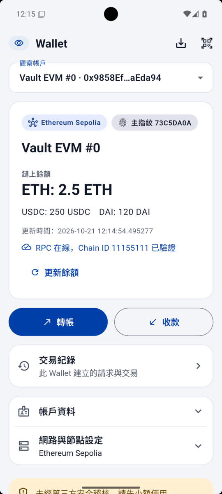<br />
      <sub>Wallet 首頁（淺色）：角色徽章、觀察帳戶、餘額（本機 Anvil 測試鏈；USDC／DAI 是截圖時放在測試鏈上、只回傳固定餘額的測試合約）</sub>
    </td>
    <td align="center" valign="top">
      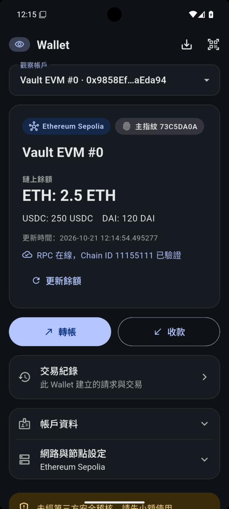<br />
      <sub>Wallet 首頁（深色，跟隨系統）</sub>
    </td>
    <td align="center" valign="top">
      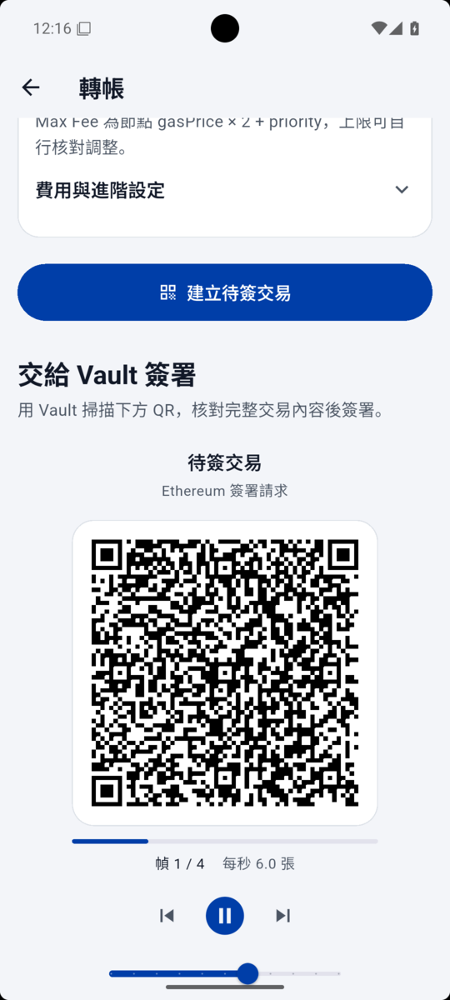<br />
      <sub>建立待簽交易後自動捲到 QR，顯示幀進度</sub>
    </td>
  </tr>
  <tr>
    <td align="center" valign="top">
      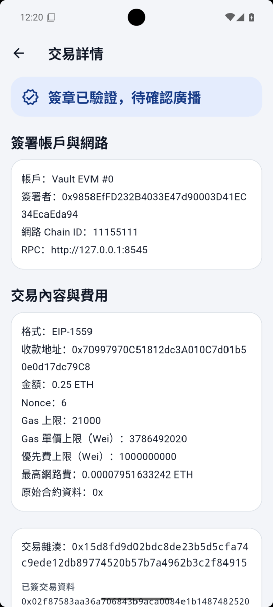<br />
      <sub>簽章已驗證，核對完整交易後廣播</sub>
    </td>
    <td align="center" valign="top">
      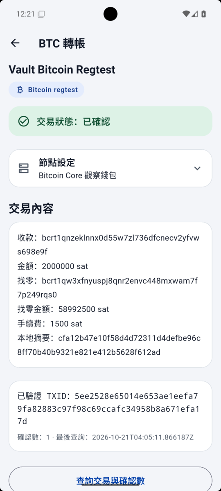<br />
      <sub>BTC 轉帳：交易狀態、交易內容、節點設定</sub>
    </td>
    <td align="center" valign="top">
      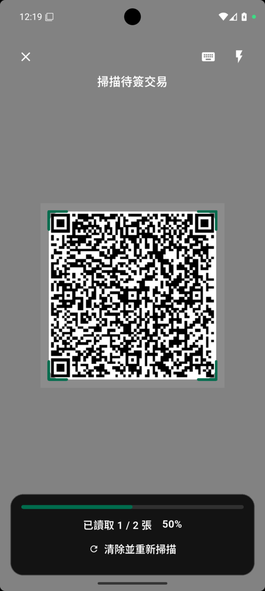<br />
      <sub>Vault 掃描器：取景遮罩、角標、幀進度、手動貼上 UR</sub>
    </td>
  </tr>
  <tr>
    <td align="center" valign="top">
      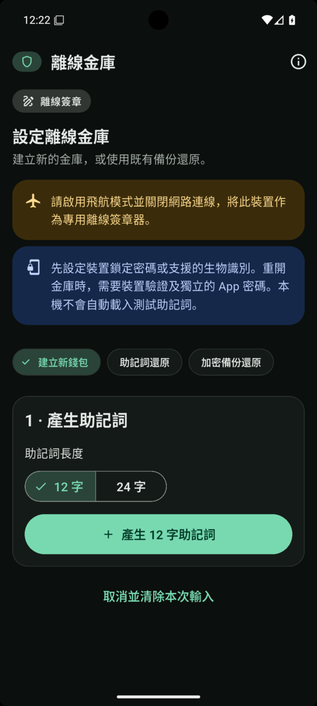<br />
      <sub>Vault 設定：強制深色、角色徽章、離線提示</sub>
    </td>
    <td align="center" valign="top">
      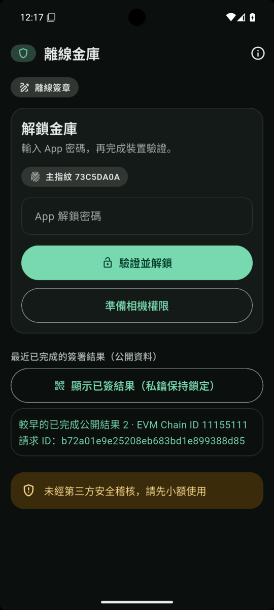<br />
      <sub>Vault 解鎖：App 密碼加裝置驗證</sub>
    </td>
    <td align="center" valign="top">
      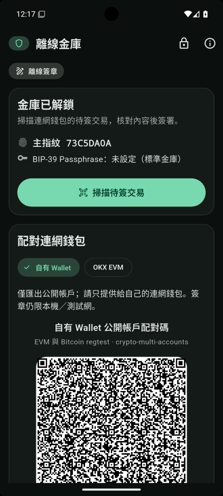<br />
      <sub>Vault 已解鎖：主指紋、掃描待簽交易、配對</sub>
    </td>
  </tr>
  <tr>
    <td align="center" valign="top">
      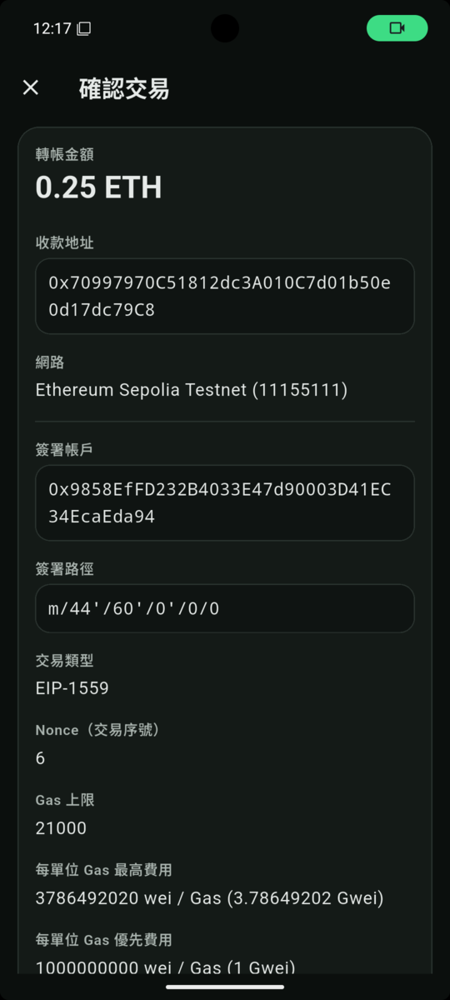<br />
      <sub>審查交易：金額在上、完整地址與參數（所見即所簽）</sub>
    </td>
    <td align="center" valign="top">
      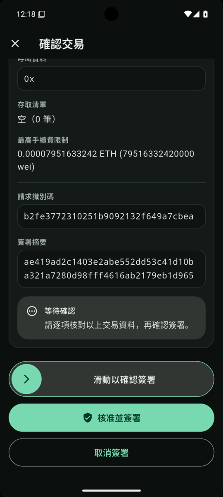<br />
      <sub>滑動確認簽署</sub>
    </td>
    <td align="center" valign="top">
      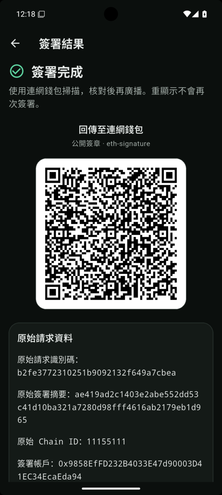<br />
      <sub>簽署結果與回傳 QR</sub>
    </td>
  </tr>
</table>

## 文件與建置指引

- [Android 優先：整合狀態與後續驗收](docs/ANDROID_STATUS.md)
- [已接受的 ADR-005](docs/ADR/ADR-005-mainnet-networks.md)
- [更新日誌（CHANGELOG）](CHANGELOG.md)
- [1.2.1+10 r25 發版與下載](https://gitlab.com/aa22396584/flutter-cold-wallet/-/releases/v1.2.1)（[歷史 1.2.1 文件](docs/releases/v1.2.1.md)）
- [1.2.0 發版說明](docs/releases/v1.2.0.md)
- [1.1.0 發版說明](docs/releases/v1.1.0.md)
- [尚未完成與後續工作清單](docs/REMAINING_WORK.md)
- [QR 核心交付說明](docs/FCW_CORE_WALLET_FIRST.md)
- [2026-10-18 修正與驗收範圍](docs/FCW_REMEDIATION_2026-10-18.md)
- [系統架構說明](docs/architecture.md)
- [威脅模型](docs/threat-model.md)

- [安全政策（SECURITY）](SECURITY.md)、[貢獻指南（CONTRIBUTING）](CONTRIBUTING.md)、[授權（LICENSE）](LICENSE)

文件中的 commit SHA、候選編號（`r9`、`r14` 等）與 APK 雜湊指向私有存檔 repo 與當時的本機建置，不一定存在於目前的 repository snapshot；舊 APK 的 PASS 不能套到新版本。建置與測試步驟見下方英文章節。

---

## Prerequisites

Versions are the ones the project is built and tested with; `tools/release_checks/check_env.py` checks them on a Windows build host.

| Tool | Version | Needed for |
|---|---|---|
| Flutter (with Dart) | 3.41.3 (Dart 3.11.1) | both apps and the Dart packages. With [fvm](https://fvm.app): `fvm install 3.41.3`, then put `~/fvm/versions/3.41.3/bin` on `PATH` (no `.fvmrc` is committed) |
| Rust | 1.96.1 (stable toolchain; no `rust-toolchain` file is pinned) | `crates/*`, `tools/okx_probe`, `tools/reference_oracle` |
| Rust targets | `aarch64-linux-android`, `x86_64-linux-android`; iOS: `aarch64-apple-ios`, `aarch64-apple-ios-sim`, `x86_64-apple-ios` | Android / iOS native libraries |
| cargo-ndk | 4.1.2 | Android native libraries |
| Android SDK + NDK | NDK 27.0.12077973, JDK 17 | Android builds (Vault `minSdk` 28) |
| Python | 3.11, plus `python3 -m pip install -r tests/requirements.txt` | host tests and tools |
| Foundry (`anvil`, `forge`) | any recent release | optional: `tests/integration/test_qr_real_node.py` |
| Bitcoin Core (`bitcoind`) | 30.2 or 31.1 were used | optional: `tests/integration/test_qr_bitcoin_regtest.py` |
| Xcode + CocoaPods | Xcode 26.3 was used | iOS only (macOS) |

## Build and test

All commands run from the repository root unless noted.

### Rust core

```sh
cargo test --workspace --locked
```

### Host native libraries for Flutter and Python tests

The Dart packages and apps load the native cores through `WALLET_FFI_PATH` and `VAULT_FFI_PATH`:

```sh
cargo build --locked -p wallet_ffi -p vault_ffi
# macOS
export WALLET_FFI_PATH="$PWD/target/debug/libwallet_ffi.dylib" VAULT_FFI_PATH="$PWD/target/debug/libvault_ffi.dylib"
# Linux: use libwallet_ffi.so / libvault_ffi.so instead
```

On Windows (PowerShell):

```powershell
cargo build --locked -p wallet_ffi -p vault_ffi
$env:WALLET_FFI_PATH = "$PWD\target\debug\wallet_ffi.dll"; $env:VAULT_FFI_PATH = "$PWD\target\debug\vault_ffi.dll"
```

### Flutter packages and apps

Run in each of `packages/public_models`, `packages/design_system`, `packages/qr_ui`, `apps/wallet` and `apps/vault`, with the variables above set:

```sh
flutter pub get
flutter analyze
flutter test
```

When `WALLET_FFI_PATH` is set, `apps/wallet/test/public_journey_composition_test.dart` also needs `FCW_JOURNEY_WALLET_FFI_SHA256` set to that library's SHA-256 (for example `shasum -a 256 "$WALLET_FFI_PATH"`).

### Python host tests

```sh
python3 -m pip install -r tests/requirements.txt
python3 -m pytest tests -q
```

Several older host-FFI suites (`tests/integration/test_g3*`, `test_g4*`, `test_g6*`, `test_g7*`) load `target/debug/*.dll` and skip on macOS and Linux; `test_fcw_core_wallet_first_qr_e2e.py` honours `WALLET_FFI_PATH` / `VAULT_FFI_PATH`. A few release-check tests expect a Windows host.

### Android APKs

macOS / Linux:

```sh
for app in wallet vault; do
  cargo ndk -t arm64-v8a -t x86_64 -o "apps/$app/android/app/src/main/jniLibs" \
    build --locked --release -p "${app}_ffi" --no-default-features
  (cd "apps/$app" && flutter build apk --release --target-platform android-arm64,android-x64)
done
```

Windows: `./tools/build_android_qr.ps1` runs the same steps (PowerShell only) and copies the APKs to `target/qr-core/`. Afterwards `python tools/release_checks/verify_qr_apks.py` checks the APKs in `target/qr-core/` for permissions, the bundled offline barcode model and the native exports; it currently uses the Windows SDK tools (`aapt.exe`, the `windows-x86_64` NDK `llvm-nm`), so it is Windows-only too. Its `--expect-cert-sha256` option pins one certificate for both APKs, but release APKs are signed with a different key per app; check those by running it without the option and comparing the signer it records for each APK, or with `apksigner verify --print-certs`, against the fingerprints in the release notes.

**Signing:** without `apps/<app>/android/key.properties` (or `FCW_KEY_PROPERTIES` pointing at one), the release build type is signed with your local Android debug keystore. Such APKs are test builds only. Never commit `key.properties` or keystores; they are git-ignored.

### iOS (macOS only)

```sh
bash tools/build_ios_core.sh            # Rust static libraries for device and simulator
cd apps/wallet && flutter build ios --no-codesign   # likewise in apps/vault
```

`mobile_scanner` 6.0.11 pulls in an ML Kit pod without an arm64 simulator slice, so Apple Silicon simulator builds currently fail; see `docs/REMAINING_WORK.md`.

## Repository layout and test tools

| Path | What it is |
|---|---|
| `apps/wallet`, `apps/vault` | the two Flutter apps |
| `packages/public_models`, `packages/qr_ui`, `packages/design_system` | shared Dart models and FFI bindings, QR scanner/player widgets, UI components |
| `crates/` | Rust core: `public_core` (parsing, policy, verification), `ur_adapter` (bounded BC-UR / CBOR), `vault_core` (keys and signing), `wallet_ffi` / `vault_ffi` (C ABI for each app), `signer_router`, `nfc_protocol` (deferred NFC transport) |
| `tools/build_android_qr.ps1` | Windows PowerShell build of both Android APKs (see above) |
| `tools/build_ios_core.sh` | macOS build of the iOS static libraries |
| `tools/release_checks/` | host checks: `check_env.py` (toolchain audit, Windows-oriented), `check_sources.py` (pins and license rows in `docs/sources.md`), `verify_qr_apks.py` (inspects built APKs; Windows-only), `verify_play_bundle.py` and `android_sdk.py` (offline Play bundle checks with cross-platform tool discovery; see [its README](tools/release_checks/README.md)), `adversarial_sources_challenge.py` (negative tests for `check_sources.py`; also fetches the source URLs) |
| `tools/reference_oracle/` | test tool: independent Rust and Python derivations of addresses from public BIP-39 vectors (`cross_verify.py` compares them), an iOS toolchain audit, and `verify_device_import.py`, which checks an Android UI dump of the OKX app against the expected public-vector address |
| `tools/okx_probe/` | test tool: Rust CLI that produces Keystone-format pairing URs and an animated QR page from the public test vector, for OKX interoperability checks |
| `tools/nfc_probe/` | test tool: Android app and adb runner for the deferred NFC transport. Its "vault" always uses the public `abandon … about` mnemonic; never use it with real funds. See its README |
| `tests/integration/`, `tests/protocol/`, `tests/adversarial/`, `tests/release_checks/`, `tests/test_nfc_*.py` | Python host tests (FFI flows, real Anvil / regtest runs, UR/CBOR protocol and adversarial inputs, tool tests, NFC APDU and runner logic) |
| `tests/android/public_review_observer/` | test tool: read-only Android helper APK that reads the Vault's public transaction-review screen during emulator runs (`build.ps1`, PowerShell) |
| `tests/fixtures/` | `local_token` (Foundry ERC-20 test token), `okx_ui_dump` (UI dumps that show only the public test-vector address) |

All keys and addresses in tests and fixtures are public test vectors (BIP-39 `abandon … about`, Trezor vectors) or Anvil default accounts. Local runs of the integration tests and tools write their records under the git-ignored `target/` directory.

## License

FCW is licensed under the GNU Affero General Public License v3.0 or later (`AGPL-3.0-or-later`, see [LICENSE](LICENSE)), with an additional permission under AGPL section 7 for linking with Google ML Kit and Google Play services libraries, which `mobile_scanner` bundles (see [LICENSE-EXCEPTION](LICENSE-EXCEPTION)). Third-party dependency licenses are summarised in [docs/sources.md](docs/sources.md); binary distributions must include their license texts.

Known friction point: the AGPL's conditions are widely considered incompatible with the Apple App Store terms, so third parties redistributing iOS builds through the App Store may not be able to comply. Distributing through other channels, or building for yourself, is not affected.

## Security and contributing

Canonical repository: <https://gitlab.com/aa22396584/flutter-cold-wallet>. See [SECURITY.md](SECURITY.md) for the current security reporting route and its limitations. See [SECURITY.md](SECURITY.md) for the current reporting limitation; never post a real mnemonic, private key or password anywhere. Contribution terms are documented in [CONTRIBUTING.md](CONTRIBUTING.md).
